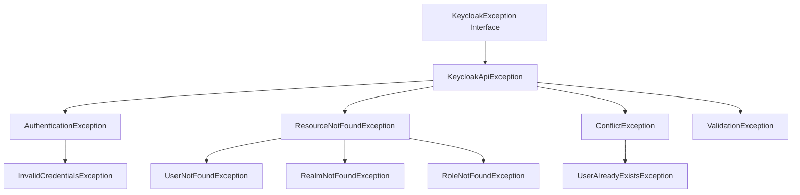

# Keycloak PHP Admin Client — Complete User Manual & Use Case Guide

This comprehensive manual details every use case, configuration option, DTO structure, and request/response payload when communicating with Keycloak using the `saifulferoz/keycloak-admin-client` PHP library and `saifulferoz/keycloak-admin-bundle`.

---

## Table of Contents

1. [Client Initialization & Authentication](#1-client-initialization--authentication)
   - [Client Credentials Grant (Service Account)](#11-client-credentials-grant-recommended-for-backend)
   - [Password Grant (Direct Admin Access)](#12-password-grant-direct-user-credentials)
   - [Token Storage Caching (PSR-16 / PSR-6)](#13-token-storage-caching-psr-16--psr-6)
   - [Custom HTTP Client & PSR-17/18 Discovery](#14-custom-http-client--psr-1718-discovery)
   - [Logging Integration (PSR-3)](#15-logging-integration-psr-3)
2. [Realm Management](#2-realm-management)
   - [List All Realms](#21-list-all-realms)
   - [Get Realm Details](#22-get-realm-details)
   - [Create Realm (Complete Payload)](#23-create-realm-complete-payload)
   - [Update Realm](#24-update-realm)
   - [Delete Realm](#25-delete-realm)
   - [Clear Realm Caches (User, Realm, Keys)](#26-clear-realm-caches)
3. [User Management](#3-user-management)
   - [Create User (Full Attributes & Password)](#31-create-user-full-attributes--password)
   - [Get User by UUID](#32-get-user-by-uuid)
   - [Advanced Querying, Filtering & Pagination](#33-advanced-querying-filtering--pagination)
   - [Count Users](#34-count-users)
   - [Update User Profile & Attributes](#35-update-user-profile--attributes)
   - [Reset / Set Password (Permanent or Temporary)](#36-reset--set-password)
   - [Send Email Verification Link](#37-send-email-verification-link)
   - [Trigger Required Actions Email (Password Reset, TOTP, Terms)](#38-trigger-required-actions-email)
   - [Inspect User Active Sessions](#39-inspect-user-active-sessions)
   - [Force Logout User](#310-force-logout-user)
   - [Delete User](#311-delete-user)
4. [Group Management & Hierarchy](#4-group-management--hierarchy)
   - [Create Root Group](#41-create-root-group)
   - [Create Child / Subgroup (Nested Hierarchy)](#42-create-child--subgroup)
   - [List & Search Groups](#43-list--search-groups)
   - [Get Group Details](#44-get-group-details)
   - [Update Group](#45-update-group)
   - [Delete Group](#46-delete-group)
   - [Manage User Group Memberships (Join / Leave)](#47-manage-user-group-memberships)
   - [List Members of a Group](#48-list-members-of-a-group)
   - [Assign Realm Roles to Group](#49-assign-realm-roles-to-group)
5. [Role Management (Realm & Client Roles)](#5-role-management-realm--client-roles)
   - [Create Realm Role](#51-create-realm-role)
   - [Get Realm Role](#52-get-realm-role)
   - [Update Realm Role](#53-update-realm-role)
   - [Delete Realm Role](#54-delete-realm-role)
   - [List Users Assigned to a Role](#55-list-users-assigned-to-a-role)
   - [Assign Realm Roles to a User](#56-assign-realm-roles-to-a-user)
   - [Remove Realm Roles from a User](#57-remove-realm-roles-from-a-user)
   - [Create Client Role](#58-create-client-role)
   - [Assign Client Roles to a User](#59-assign-client-roles-to-a-user)
6. [Client Management (OIDC & SAML Applications)](#6-client-management-oidc--saml-applications)
   - [Create Confidential Backend Client (Service Account Enabled)](#61-create-confidential-backend-client)
   - [Create Public Frontend Client (SPA / Mobile App)](#62-create-public-frontend-client)
   - [List & Search Clients](#63-list--search-clients)
   - [Find Client by `clientId`](#64-find-client-by-clientid)
   - [Get / Regenerate Client Secret](#65-get--regenerate-client-secret)
   - [Get Service Account User for Client](#66-get-service-account-user-for-client)
   - [Update & Delete Client](#67-update--delete-client)
7. [Identity Providers (Social & Enterprise IdP)](#7-identity-providers-social--enterprise-idp)
   - [Create Identity Provider (Google, GitHub, Custom OIDC)](#71-create-identity-provider)
   - [List & Get Identity Providers](#72-list--get-identity-providers)
   - [Update & Delete Identity Provider](#73-update--delete-identity-provider)
8. [Attack Detection & Brute-Force Protection](#8-attack-detection--brute-force-protection)
   - [Check User Lockout Status](#81-check-user-lockout-status)
   - [Clear User Brute Force Lockout](#82-clear-user-brute-force-lockout)
   - [Clear All Realm Lockouts](#83-clear-all-realm-lockouts)
9. [Session Management](#9-session-management)
   - [List User Active Sessions](#91-list-user-active-sessions)
   - [List Client Active Sessions](#92-list-client-active-sessions)
   - [Revoke Specific Session ID](#93-revoke-specific-session-id)
   - [Revoke All Sessions in Realm (Logout All)](#94-revoke-all-sessions-in-realm)
10. [Error Handling & Domain Exception Reference](#10-error-handling--domain-exception-reference)
11. [Symfony Bundle Recipes](#11-symfony-bundle-recipes)

---

## 1. Client Initialization & Authentication

### 1.1 Client Credentials Grant (Recommended for Backend)
Uses OAuth2 Service Account credentials (`client_credentials` grant):

```php
use Feroz\KeycloakAdmin\KeycloakClient;

$client = KeycloakClient::builder()
    ->withBaseUrl('https://iam.example.com')
    ->withAuthRealm('master')                     // Realm for admin auth (default: 'master')
    ->withDefaultTargetRealm('mycompany')        // Default realm for all CRUD operations
    ->withClientCredentials('admin-cli', 'your-client-secret')
    ->withTimeout(15.0)                          // Request timeout in seconds
    ->withVerifySsl(true)
    ->build();

// Test connection
if ($client->ping()) {
    echo "Connected successfully to Keycloak!";
}
```

### 1.2 Password Grant (Direct User Credentials)
Authenticates as an administrative user directly:

```php
$client = KeycloakClient::builder()
    ->withBaseUrl('https://iam.example.com')
    ->withAuthRealm('master')
    ->withDefaultTargetRealm('mycompany')
    ->withPasswordCredentials(
        clientId: 'admin-cli',
        username: 'admin',
        password: 'SuperAdminPassword123!',
        clientSecret: null // optional
    )
    ->build();
```

### 1.3 Token Storage Caching (PSR-16 / PSR-6)
To avoid obtaining a new OAuth2 access token on every PHP request lifecycle, pass any PSR-16 `CacheInterface` (e.g. Symfony Cache, Redis, Memcached, APCu):

```php
use Symfony\Component\Cache\Adapter\RedisAdapter;
use Symfony\Component\Cache\Psr16Cache;

$redisConnection = RedisAdapter::createConnection('redis://localhost:6379');
$cache = new Psr16Cache(new RedisAdapter($redisConnection));

$client = KeycloakClient::builder()
    ->withBaseUrl('https://iam.example.com')
    ->withClientCredentials('admin-cli', 'your-client-secret')
    ->withCache($cache, prefix: 'my_app_keycloak_')
    ->build();
```

### 1.4 Custom HTTP Client & PSR-17/18 Discovery
If you want to provide your own PSR-18 HTTP Client (such as Guzzle with custom middlewares, or Symfony HttpClient):

```php
use GuzzleHttp\Client as GuzzleClient;
use GuzzleHttp\Psr7\HttpFactory;

$guzzle = new GuzzleClient([
    'timeout' => 30.0,
    'proxy' => 'http://proxy.internal:8080',
]);

$factory = new HttpFactory();

$client = KeycloakClient::builder()
    ->withBaseUrl('https://iam.example.com')
    ->withClientCredentials('admin-cli', 'secret')
    ->withPsr18Client($guzzle, $factory, $factory)
    ->build();
```

### 1.5 Logging Integration (PSR-3)
Pass any PSR-3 Logger (Monolog, etc.) for automated HTTP debugging:

```php
$client = KeycloakClient::builder()
    ->withBaseUrl('https://iam.example.com')
    ->withClientCredentials('admin-cli', 'secret')
    ->withLogger($monologLogger)
    ->build();
```

---

## 2. Realm Management

### 2.1 List All Realms
```php
$realms = $client->realms()->all();

foreach ($realms as $realm) {
    echo "Realm: " . $realm->realm . " | Enabled: " . ($realm->enabled ? 'Yes' : 'No') . PHP_EOL;
}
```

### 2.2 Get Realm Details
```php
$realm = $client->realms()->get('mycompany');

echo "Display Name: " . $realm->displayName . PHP_EOL;
echo "Token Lifespan: " . $realm->accessTokenLifespan . "s" . PHP_EOL;
echo "SSO Session Idle: " . $realm->ssoSessionIdleTimeout . "s" . PHP_EOL;
```

### 2.3 Create Realm (Complete Payload)
```php
use Feroz\KeycloakAdmin\Model\Realm\RealmRepresentation;

$newRealm = new RealmRepresentation(
    id: 'ecommerce-tenant',
    realm: 'ecommerce-tenant',
    displayName: 'E-Commerce Platform',
    displayNameHtml: '<div class="kc-logo-text"><span>E-Commerce</span> Platform</div>',
    enabled: true,
    registrationAllowed: true,              // Allow self-registration
    registrationEmailAsUsername: true,      // Use email as username
    rememberMe: true,
    verifyEmail: true,                      // Require email confirmation
    loginWithEmailAllowed: true,
    duplicateEmailsAllowed: false,
    resetPasswordAllowed: true,             // Enable 'Forgot Password' link
    editUsernameAllowed: false,
    accessTokenLifespan: 300,               // 5 minutes
    ssoSessionIdleTimeout: 1800,            // 30 minutes
    ssoSessionMaxLifespan: 36000,           // 10 hours
    sslRequired: 'external',                // 'all', 'external', 'none'
    supportedLocales: ['en', 'de', 'fr', 'es'],
    defaultLocale: 'en',
    smtpServer: [
        'host' => 'smtp.mailgun.org',
        'port' => '587',
        'from' => 'auth@example.com',
        'fromDisplayName' => 'E-Commerce Security',
        'auth' => 'true',
        'user' => 'postmaster@example.com',
        'password' => 'smtp-password-123',
        'starttls' => 'true'
    ],
    attributes: [
        'frontendUrl' => 'https://auth.example.com',
        'userProfileEnabled' => 'true'
    ]
);

$client->realms()->create($newRealm);
```

### 2.4 Update Realm
```php
$updatedRealm = new RealmRepresentation(
    displayName: 'Updated E-Commerce Portal',
    resetPasswordAllowed: true,
    accessTokenLifespan: 600
);

$client->realms()->update('ecommerce-tenant', $updatedRealm);
```

### 2.5 Delete Realm
```php
$client->realms()->delete('ecommerce-tenant');
```

### 2.6 Clear Realm Caches
```php
// Clear User Cache (e.g. after database migration or manual LDAP sync)
$client->realms()->clearUserCache('mycompany');

// Clear Realm Configuration Cache
$client->realms()->clearRealmCache('mycompany');

// Clear Realm Active Signing Keys Cache
$client->realms()->clearKeysCache('mycompany');
```

---

## 3. User Management

### 3.1 Create User (Full Attributes & Password)
```php
use Feroz\KeycloakAdmin\Model\Enum\RequiredAction;
use Feroz\KeycloakAdmin\Model\User\UserRepresentation;

$userDto = UserRepresentation::create(email: 'saiful.feroz@example.com', username: 'saiful.feroz')
    ->withName(firstName: 'Saiful', lastName: 'Feroz')
    ->withEmailVerified(true)
    ->withAttribute('department', ['Engineering', 'Architecture'])
    ->withAttribute('phoneNumber', '+1234567890')
    ->withAttribute('costCenter', 'CC-9041')
    ->withPassword(password: 'InitialPassword@2026', temporary: true)
    ->withRequiredActions([
        RequiredAction::UPDATE_PASSWORD,
        RequiredAction::CONFIGURE_TOTP,
    ]);

// Creates user in default target realm and returns the generated UUID
$userId = $client->users()->create($userDto);

echo "Created User UUID: " . $userId;
```

### 3.2 Get User by UUID
```php
$user = $client->users()->get($userId);

echo "Username: " . $user->username . PHP_EOL;
echo "Email: " . $user->email . PHP_EOL;
echo "Created: " . date('Y-m-d H:i:s', (int)($user->createdTimestamp / 1000)) . PHP_EOL;
print_r($user->attributes);
```

### 3.3 Advanced Querying, Filtering & Pagination
The `UserQuery` builder supports all Keycloak Admin search filters:

```php
use Feroz\KeycloakAdmin\Query\UserQuery;

$query = UserQuery::create()
    ->withSearch('feroz')                          // Searches username, first/last name, email
    ->withEnabled(true)                            // Only active accounts
    ->withEmailVerified(true)                      // Only verified emails
    ->withAttributeFilter('department', 'Engineering') // Custom attribute filter (q syntax)
    ->withPagination(page: 1, perPage: 25);        // Automatically calculates offset

$paginatedUsers = $client->users()->list($query);

echo "Total items on page: " . $paginatedUsers->count() . PHP_EOL;

foreach ($paginatedUsers as $u) {
    echo sprintf("[%s] %s (%s)\n", $u->id, $u->username, $u->email);
}
```

#### Exact Matching Query
```php
$exactQuery = UserQuery::create()
    ->withUsername('saiful.feroz')
    ->withExact(true);

$result = $client->users()->list($exactQuery);
$user = $result->getItems()[0] ?? null;
```

### 3.4 Count Users
```php
$count = $client->users()->count(
    UserQuery::create()->withEnabled(true)
);

echo "Total active users: " . $count;
```

### 3.5 Update User Profile & Attributes
```php
$existingUser = $client->users()->get($userId);

$updatedUser = $existingUser
    ->withName('Saiful', 'Feroz (Architect)')
    ->withAttribute('jobTitle', 'Lead Architect')
    ->withAttribute('tier', 'Enterprise');

$client->users()->update($userId, $updatedUser);
```

### 3.6 Reset / Set Password
```php
// Reset password with requirement to change on first login
$client->users()->resetPassword(
    userId: $userId,
    newPassword: 'NewSecurePassword123!',
    temporary: true // Set to false for permanent password
);
```

### 3.7 Send Email Verification Link
Sends the standard Keycloak email containing the email verification link:

```php
$client->users()->sendVerifyEmail(
    userId: $userId,
    clientId: 'web-frontend',                                    // optional
    redirectUri: 'https://app.example.com/welcome'              // optional
);
```

### 3.8 Trigger Required Actions Email
Sends an email inviting the user to execute specific required actions (e.g. password reset or 2FA setup):

```php
use Feroz\KeycloakAdmin\Model\Enum\RequiredAction;

$client->users()->executeActionsEmail(
    userId: $userId,
    actions: [
        RequiredAction::UPDATE_PASSWORD,
        RequiredAction::CONFIGURE_TOTP,
        RequiredAction::UPDATE_PROFILE,
    ],
    lifespan: 7200, // Link validity in seconds (2 hours)
    clientId: 'web-frontend',
    redirectUri: 'https://app.example.com/dashboard'
);
```

### 3.9 Inspect User Active Sessions
```php
$sessions = $client->users()->getUserSessions($userId);

foreach ($sessions as $session) {
    echo "Session ID: " . $session->id . PHP_EOL;
    echo "IP Address: " . $session->ipAddress . PHP_EOL;
    echo "Started: " . date('Y-m-d H:i:s', (int)($session->start / 1000)) . PHP_EOL;
    echo "Clients: " . implode(', ', array_values($session->clients ?? [])) . PHP_EOL;
}
```

### 3.10 Force Logout User
Terminates all active user sessions across all clients and invalidates refresh tokens:

```php
$client->users()->logout($userId);
```

### 3.11 Delete User
```php
$client->users()->delete($userId);
```

---

## 4. Group Management & Hierarchy

### 4.1 Create Root Group
```php
use Feroz\KeycloakAdmin\Model\Group\GroupRepresentation;

$group = GroupRepresentation::create('Engineering');

$groupId = $client->groups()->create($group);
echo "Created Group UUID: " . $groupId;
```

### 4.2 Create Child / Subgroup (Nested Hierarchy)
Creates nested sub-groups like `/Engineering/Backend`:

```php
$subGroup = GroupRepresentation::create('Backend Team');

$subGroupId = $client->groups()->createChildGroup(
    parentGroupId: $groupId,
    group: $subGroup
);
```

### 4.3 List & Search Groups
```php
use Feroz\KeycloakAdmin\Query\GroupQuery;

$query = GroupQuery::create()
    ->withSearch('Backend')
    ->withPagination(page: 1, perPage: 10)
    ->withPopulateHierarchy(true);

$groups = $client->groups()->list($query);

foreach ($groups as $g) {
    echo sprintf("[%s] %s (Path: %s)\n", $g->id, $g->name, $g->path);
}
```

### 4.4 Get Group Details
```php
$group = $client->groups()->get($groupId);
echo "Group Path: " . $group->path;
```

### 4.5 Update Group
```php
$updated = new GroupRepresentation(name: 'Core Engineering');
$client->groups()->update($groupId, $updated);
```

### 4.6 Delete Group
```php
$client->groups()->delete($groupId);
```

### 4.7 Manage User Group Memberships
```php
// Add user to group
$client->users()->joinGroup($userId, $groupId);

// Check user's assigned groups
$userGroups = $client->users()->getUserGroups($userId);
foreach ($userGroups as $grp) {
    echo "Member of: " . $grp->name . PHP_EOL;
}

// Remove user from group
$client->users()->leaveGroup($userId, $groupId);
```

### 4.8 List Members of a Group
```php
$members = $client->groups()->getMembers($groupId, first: 0, max: 50);

foreach ($members as $member) {
    echo "Member: " . $member->username . " (" . $member->email . ")" . PHP_EOL;
}
```

### 4.9 Assign Realm Roles to Group
```php
$adminRole = $client->roles()->getRealmRole('admin');

$client->groups()->addRealmRoleMappings($groupId, [$adminRole]);
```

---

## 5. Role Management (Realm & Client Roles)

### 5.1 Create Realm Role
```php
use Feroz\KeycloakAdmin\Model\Role\RoleRepresentation;

$role = RoleRepresentation::create(
    name: 'organization-admin',
    description: 'Full administrative access across organization resources'
);

$client->roles()->createRealmRole($role);
```

### 5.2 Get Realm Role
```php
$role = $client->roles()->getRealmRole('organization-admin');
echo "Role ID: " . $role->id . " | Description: " . $role->description;
```

### 5.3 Update Realm Role
```php
$updated = RoleRepresentation::create(
    name: 'organization-admin',
    description: 'Updated description: Superuser access'
);

$client->roles()->updateRealmRole('organization-admin', $updated);
```

### 5.4 Delete Realm Role
```php
$client->roles()->deleteRealmRole('organization-admin');
```

### 5.5 List Users Assigned to a Role
```php
$users = $client->roles()->getRoleUsers('organization-admin', first: 0, max: 20);

foreach ($users as $user) {
    echo "User with role: " . $user->username . PHP_EOL;
}
```

### 5.6 Assign Realm Roles to a User
```php
$role = $client->roles()->getRealmRole('organization-admin');

// Assign role
$client->users()->addRealmRoleMappings($userId, [$role]);

// Inspect assigned realm roles
$assignedRoles = $client->users()->getRealmRoleMappings($userId);
foreach ($assignedRoles as $r) {
    echo "Assigned Role: " . $r->name . PHP_EOL;
}
```

### 5.7 Remove Realm Roles from a User
```php
$role = $client->roles()->getRealmRole('organization-admin');

$client->users()->deleteRealmRoleMappings($userId, [$role]);
```

### 5.8 Create Client Role
```php
$clientUuid = $client->clients()->findByClientId('my-microservice')->id;

$clientRole = RoleRepresentation::create(
    name: 'report:read',
    description: 'Permission to read financial reports'
);

$client->roles()->createClientRole($clientUuid, $clientRole);
```

### 5.9 Assign Client Roles to a User
```php
$role = $client->roles()->getClientRole($clientUuid, 'report:read');

$client->users()->addClientRoleMappings($userId, $clientUuid, [$role]);

// List user's client roles
$roles = $client->users()->getClientRoleMappings($userId, $clientUuid);
```

---

## 6. Client Management (OIDC & SAML Applications)

### 6.1 Create Confidential Backend Client (Service Account Enabled)
```php
use Feroz\KeycloakAdmin\Model\Client\ClientRepresentation;

$backendClient = new ClientRepresentation(
    clientId: 'order-processing-service',
    name: 'Order Processing Service',
    description: 'Backend microservice communicating via OAuth2 Client Credentials',
    enabled: true,
    publicClient: false,                   // Confidential client
    bearerOnly: false,
    serviceAccountsEnabled: true,          // Enable Service Account (client_credentials grant)
    directAccessGrantsEnabled: false,
    standardFlowEnabled: false,            // Disable browser auth redirect flow
    protocol: 'openid-connect'
);

$clientUuid = $client->clients()->create($backendClient);
echo "Created Client UUID: " . $clientUuid;
```

### 6.2 Create Public Frontend Client (SPA / Mobile App)
```php
$frontendClient = new ClientRepresentation(
    clientId: 'angular-spa-frontend',
    name: 'Angular SPA Dashboard',
    enabled: true,
    publicClient: true,                    // Public client (no client secret)
    standardFlowEnabled: true,             // Authorization Code Flow with PKCE
    directAccessGrantsEnabled: false,
    redirectUris: [
        'https://app.example.com/*',
        'http://localhost:4200/*'
    ],
    webOrigins: [
        'https://app.example.com',
        'http://localhost:4200'
    ]
);

$clientUuid = $client->clients()->create($frontendClient);
```

### 6.3 List & Search Clients
```php
use Feroz\KeycloakAdmin\Query\ClientQuery;

$query = ClientQuery::create()
    ->withSearch('order')
    ->withPagination(page: 1, perPage: 10);

$clients = $client->clients()->list($query);
foreach ($clients as $c) {
    echo sprintf("[%s] %s (Public: %s)\n", $c->id, $c->clientId, $c->publicClient ? 'Yes' : 'No');
}
```

### 6.4 Find Client by `clientId`
```php
$clientRep = $client->clients()->findByClientId('order-processing-service');

if ($clientRep !== null) {
    echo "Found Client UUID: " . $clientRep->id;
}
```

### 6.5 Get / Regenerate Client Secret
```php
// Retrieve active secret
$secret = $client->clients()->getClientSecret($clientUuid);
echo "Current Secret: " . $secret . PHP_EOL;

// Regenerate a new secret
$newSecret = $client->clients()->regenerateClientSecret($clientUuid);
echo "New Secret: " . $newSecret . PHP_EOL;
```

### 6.6 Get Service Account User for Client
Each client with `serviceAccountsEnabled = true` has an underlying Keycloak user representing the service account:

```php
$serviceAccountUser = $client->clients()->getServiceAccountUser($clientUuid);

echo "Service Account User UUID: " . $serviceAccountUser->id . PHP_EOL;
echo "Service Account Username: " . $serviceAccountUser->username . PHP_EOL;

// You can now assign realm roles to this service account:
$adminRole = $client->roles()->getRealmRole('admin');
$client->users()->addRealmRoleMappings($serviceAccountUser->id, [$adminRole]);
```

### 6.7 Update & Delete Client
```php
// Update
$updatedClient = new ClientRepresentation(
    name: 'Updated Order Service Name',
    redirectUris: ['https://app.example.com/callback']
);
$client->clients()->update($clientUuid, $updatedClient);

// Delete
$client->clients()->delete($clientUuid);
```

---

## 7. Identity Providers (Social & Enterprise IdP)

### 7.1 Create Identity Provider
```php
use Feroz\KeycloakAdmin\Model\IdP\IdentityProviderRepresentation;

// Google Social Login
$googleIdp = new IdentityProviderRepresentation(
    alias: 'google',
    displayName: 'Google Workspace',
    providerId: 'google',
    enabled: true,
    trustEmail: true,
    storeToken: false,
    config: [
        'clientId' => 'google-client-id.apps.googleusercontent.com',
        'clientSecret' => 'GOCSPX-your-secret-key',
        'defaultScope' => 'openid profile email',
    ]
);

$client->identityProviders()->create($googleIdp);
```

### 7.2 List & Get Identity Providers
```php
$idps = $client->identityProviders()->all();
foreach ($idps as $idp) {
    echo "IdP: " . $idp->alias . " (" . $idp->providerId . ")" . PHP_EOL;
}

$google = $client->identityProviders()->get('google');
```

### 7.3 Update & Delete Identity Provider
```php
// Update
$google->enabled = false;
$client->identityProviders()->update('google', $google);

// Delete
$client->identityProviders()->delete('google');
```

---

## 8. Attack Detection & Brute-Force Protection

Keycloak has built-in brute-force attack detection that temporarily locks users out upon repeated failed login attempts.

### 8.1 Check User Lockout Status
```php
$status = $client->attackDetection()->getUserStatus($userId);

echo "Failed Attempts: " . $status->numFailures . PHP_EOL;
echo "Is Disabled/Locked: " . ($status->disabled ? 'YES' : 'NO') . PHP_EOL;
echo "Last Failure IP: " . ($status->lastIPFailure ?? 'N/A') . PHP_EOL;
```

### 8.2 Clear User Brute Force Lockout
Clears failure counters and instantly unlocks the user account:

```php
$client->attackDetection()->clearUserStatus($userId);
echo "User lockout cleared successfully.";
```

### 8.3 Clear All Realm Lockouts
```php
$client->attackDetection()->clearAllUsersStatus();
```

---

## 9. Session Management

### 9.1 List User Active Sessions
```php
$userSessions = $client->sessions()->getUserSessions($userId);

foreach ($userSessions as $session) {
    echo "Session ID: " . $session->id . " | IP: " . $session->ipAddress . PHP_EOL;
}
```

### 9.2 List Client Active Sessions
```php
$clientSessions = $client->sessions()->getClientUserSessions($clientUuid, first: 0, max: 100);

echo "Active sessions on client: " . count($clientSessions);
```

### 9.3 Revoke Specific Session ID
```php
$client->sessions()->deleteUserSession($session->id);
```

### 9.4 Revoke All Sessions in Realm (Logout All)
```php
$client->sessions()->logoutAll();
```

---

## 10. Error Handling & Domain Exception Reference

The library converts all raw Keycloak HTTP error responses into structured PHP domain exceptions:



### Handling Exceptions in Application Code:

```php
use Feroz\KeycloakAdmin\Exception\Auth\AuthenticationException;
use Feroz\KeycloakAdmin\Exception\Auth\InvalidCredentialsException;
use Feroz\KeycloakAdmin\Exception\KeycloakApiException;
use Feroz\KeycloakAdmin\Exception\Resource\UserAlreadyExistsException;
use Feroz\KeycloakAdmin\Exception\Resource\UserNotFoundException;
use Feroz\KeycloakAdmin\Exception\Resource\ValidationException;

try {
    $userId = $client->users()->create($userDto);
} catch (UserAlreadyExistsException $e) {
    // HTTP 409 Conflict
    echo "Cannot create user: A user with this username or email already exists.\n";
} catch (ValidationException $e) {
    // HTTP 400 Bad Request
    echo "Validation error from Keycloak: " . $e->getMessage() . "\n";
    print_r($e->getResponseBody());
} catch (InvalidCredentialsException $e) {
    // HTTP 401 Unauthorized during admin token acquisition
    echo "Admin authentication failed: Check client_id and client_secret.\n";
} catch (UserNotFoundException $e) {
    // HTTP 404
    echo "Requested user was not found.\n";
} catch (KeycloakApiException $e) {
    // Any other Keycloak REST error
    echo "Keycloak API Error (Status " . $e->getStatusCode() . "): " . $e->getMessage() . "\n";
}
```

---

## 11. Symfony Bundle Recipes

### 11.1 Standard Controller with Autowiring

```php
namespace App\Controller;

use Feroz\KeycloakAdmin\KeycloakClientInterface;
use Feroz\KeycloakAdmin\Model\User\UserRepresentation;
use Symfony\Bundle\FrameworkBundle\Controller\AbstractController;
use Symfony\Component\HttpFoundation\JsonResponse;
use Symfony\Component\HttpFoundation\Request;
use Symfony\Component\Routing\Attribute\Route;

final class RegistrationController extends AbstractController
{
    #[Route('/api/register', methods: ['POST'])]
    public function register(Request $request, KeycloakClientInterface $keycloak): JsonResponse
    {
        $payload = $request->toArray();

        $user = UserRepresentation::create($payload['email'], $payload['username'])
            ->withName($payload['firstName'], $payload['lastName'])
            ->withPassword($payload['password'])
            ->withEmailVerified(false);

        $userId = $keycloak->users()->create($user);

        // Send verification email
        $keycloak->users()->sendVerifyEmail($userId);

        return new JsonResponse(['id' => $userId, 'message' => 'User created'], 201);
    }
}
```

### 11.2 Multi-Tenant Service with `KeycloakClientRegistry`

```php
namespace App\Service;

use Feroz\KeycloakAdminBundle\Factory\KeycloakClientRegistry;

final class TenantUserManager
{
    public function __construct(
        private readonly KeycloakClientRegistry $registry
    ) {
    }

    public function createTenantUser(string $tenantKey, string $email, string $username): string
    {
        // Dynamically retrieves configured tenant client
        $tenantClient = $this->registry->getClient($tenantKey);

        return $tenantClient->users()->create(
            UserRepresentation::create($email, $username)
        );
    }
}
```
